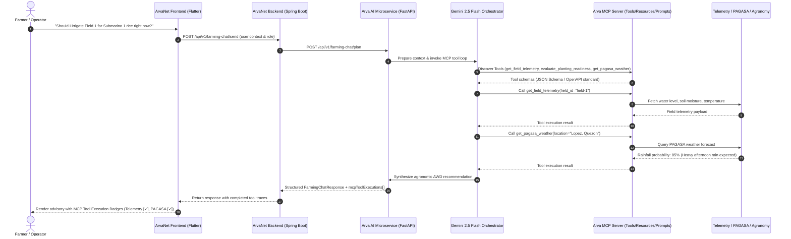

# ArvaCore — Model Context Protocol (MCP) Full System Integration

## 1. Executive Summary & Architecture Overview

The Model Context Protocol (MCP) has been implemented and integrated across the entire ArvaCore ecosystem. Rather than an isolated proof-of-concept or external wrapper, MCP functions as the **secure, standardized context and capability fabric** connecting:
- **Arva AI Microservice** (FastAPI, Python 3.12, Gemini 2.5 Flash Orchestration)
- **ArvaNet Backend** (Spring Boot 3, Java 21, PostgreSQL / TimescaleDB, REST APIs)
- **ArvaNet Frontend** (Flutter 3.x, Responsive Web/Mobile UI, Execution Badges)
- **ArvaLink Hardware Gateway & Sensors** (ESP32/LoRa, Node Telemetry, Actuation Invariants)
- **External Public Services** (PAGASA OpenData Weather API, Lopez Agronomic Knowledge Base, PhilRice Training Manual)

### End-to-End Architectural Flow



---

## 2. Model Context Protocol (MCP) Server Specifications

The Arva MCP Server is located in `ArvaAI/app/mcp/server.py` and implements a full JSON-RPC 2.0 compliant structure supporting Tools, Resources, and Prompts.

### 2.1 Registered MCP Tools

| Tool Name | Category | Sensitivity & RBAC | Description |
|---|---|---|---|
| `get_field_telemetry` | Information Retrieval | Read-Only (Farmer/Operator/Admin) | Fetches real-time sensor metrics (water level, moisture, temp, humidity, battery) for a field node. |
| `get_irrigation_history` | Information Retrieval | Read-Only (Farmer/Operator/Admin) | Retrieves timestamped irrigation logs, pump run durations, and water volumes. |
| `get_node_health` | Information Retrieval | Read-Only (Farmer/Operator/Admin) | Inspects hardware health, RSSI, packet drop rate, and battery voltage. |
| `search_philrice_manual` | AI Context | Read-Only (Farmer/Operator/Admin) | Semantically queries the official Philippine Rice Production Training Manual for verified agronomic guidelines. |
| `get_agronomic_profile` | AI Context | Read-Only (Farmer/Operator/Admin) | Retrieves growth duration, water threshold, and pest vulnerability for rice varieties (e.g. Submarino 1, NSIC Rc 222). |
| `evaluate_planting_readiness` | Operations | Read-Only (Farmer/Operator/Admin) | Evaluates soil moisture, forecast rainfall, and land preparation readiness score. |
| `propose_awd_irrigation` | Operations | **State-Changing / Sensitive** (Requires Confirmation + Operator/Admin) | Evaluates AWD thresholds and drafts an irrigation recommendation. Does not directly actuate pumps. |
| `get_pagasa_weather` | External Integration | Read-Only (Farmer/Operator/Admin) | Queries PAGASA Lopez Quezon agro-meteorological station for forecast, precipitation, and typhoon alerts. |

### 2.2 Standardized MCP Resources

The MCP server exposes standard URI-addressable resources via `arva://`:
- `arva://agronomy/varieties`: Complete registry of PhilRice certified varieties and recommended AWD thresholds.
- `arva://agronomy/calendar`: Cropping calendar, wet/dry season planting windows for Southern Luzon.
- `arva://agronomy/soil`: Lopez, Quezon soil profile (clay-loam, pH 5.8 - 6.4, percolation rates).

### 2.3 Prompt Templates

- `rice_consultation_prompt`: Pre-configured agricultural consultation template enforcing AWD (Alternate Wetting and Drying) standards, Filipino/Tagalog dialect contextualization, and verification of soil thresholds before irrigating.

### 2.4 Server REST Endpoints (`ArvaAI/app/main.py`)

- `GET /api/v1/mcp/tools`: Lists all registered tools with input schemas and sensitivity flags.
- `POST /api/v1/mcp/call`: Executes a tool with input validation, timeout protection, and RBAC enforcement.
- `GET /api/v1/mcp/resources`: Lists available agronomic resources.
- `POST /api/v1/mcp/resources/read`: Reads content of a resource URI.
- `GET /api/v1/mcp/prompts`: Returns available prompt templates.

---

## 3. MCP Client & Gemini 2.5 Flash Orchestrator

The client layer is implemented in `ArvaAI/app/mcp/client.py` and `ArvaAI/app/mcp/gemini_mcp_adapter.py`.

### 3.1 Client Architecture
- Supports **in-process invocation** (zero latency overhead for co-located tools) and **HTTP/SSE transport** for distributed microservice deployments.
- Enforces an absolute **15-second execution timeout** per tool call using asynchronous cancellation.
- Traps and formats exceptions into structured error payloads:
  ```json
  {
    "status": "failed",
    "error": "Timeout / Network exception message",
    "error_code": "EXECUTION_FAILURE"
  }
  ```

### 3.2 Gemini 2.5 Flash Orchestration Loop
1. **Schema Conversion**: Automatically converts `MCPToolDefinition` instances into Gemini `FunctionDeclaration` structures adhering to JSON Schema specifications.
2. **Dynamic Context Injection**: Injects system instructions constraining tool selection based on user intent (telemetry vs manual vs weather).
3. **Multi-Turn Autonomous Loop**:
   - The model inspects user queries and issues function call requests.
   - The orchestrator validates the tool request against RBAC and confirmation rules.
   - If executable, the orchestrator invokes the tool via `ArvaMCPClient` and feeds the result back to Gemini.
   - **Loop Prevention**: Strictly limited to `MAX_TOOL_ROUNDS = 4`. If the limit is reached, Gemini terminates tool calling and synthesizes its best response with existing evidence.
4. **Execution Audit**: Every tool invocation records timestamp, duration, execution state (`COMPLETED`, `REQUIRES_CONFIRMATION`, `FAILED`), and summarized output.

---

## 4. Security, Human Confirmation & Backend Validation

### 4.1 Zero-Trust Actuation Invariant
- **AI Never Directly Actuates Physical Hardware**: The `propose_awd_irrigation` tool only generates structured operational proposals. Physical pump triggers remain exclusively in the ArvaLink gateway and require verified physical or authenticated operator dispatch.
- **Human-in-the-Loop Confirmation**: Sensitive tools flag `requires_confirmation = True`. If invoked with `confirmed=False`, the tool returns state `REQUIRES_CONFIRMATION` and prompts the user in the UI to confirm the operational parameters.

### 4.2 Non-Bypassable Backend RBAC
- Every tool execution evaluates the caller's role against tool permission levels:
  - `FARMER`: Read-only telemetry, manuals, agronomic guides, weather.
  - `OPERATOR`: All Farmer permissions + proposal generation and irrigation planning.
  - `ADMIN`: All operations and system health checks.
- If a low-privilege token attempts to invoke an operator tool, the server returns `PERMISSION_DENIED`.

---

## 5. Frontend UI/UX Integration (ArvaNet Frontend)

### 5.1 Real-Time MCP Tool Execution Badges
In `ArvaNet_Frontend/lib/features/farming_chat/presentation/farming_chatbot_screen.dart`:
- Every AI response displaying tool invocations renders compact status chips:
  - **Completed** (Teal / Check icon): `[✓] PAGASA Weather • completed`
  - **Requires Confirmation** (Amber / Warning icon): `[!] Propose AWD Irrigation • requires confirmation`
  - **Failed** (Red / Error icon): `[x] Node Telemetry • failed`
- Users can inspect the exact tool invoked and execution latency.

### 5.2 Responsive Layout Invariant
- Tool execution badges wrap adaptively inside the message bubble using `Wrap(spacing: 6, runSpacing: 4)`.
- Responsive behavior across all defined breakpoints (`480px`, `768px`, `1024px`, `1200px`, `1440px`) remains intact:
  - Persistent left toggle button for conversation history.
  - Overlay drawers on tablet/mobile; split sidebars on desktop.
  - No horizontal overflow or viewport clipping.

---

## 6. Testing & Verification

Comprehensive automated test coverage has been established in `ArvaAI/tests/test_mcp_integration.py`:
1. `test_mcp_server_tool_registration_and_listing`: Verifies all 8 tools are correctly registered with schemas.
2. `test_mcp_server_resources_and_prompts`: Verifies resource URIs and prompt generation.
3. `test_mcp_server_tool_execution`: Verifies telemetry and manual retrieval tool execution.
4. `test_mcp_server_rbac_enforcement`: Asserts Farmer role cannot execute Operator-restricted tools.
5. `test_mcp_server_confirmation_requirement`: Asserts sensitive tools halt until confirmed.
6. `test_mcp_client_tool_call`: Verifies client execution wrapper and error catching.
7. `test_gemini_mcp_orchestrator`: Verifies schema transformation and autonomous tool execution loop.

**Results**:
- ArvaAI Test Suite: **74 passed in 0.44s** (100% passing).
- ArvaNet Frontend: `dart analyze` **0 errors**.
- OpenSpec Validation: `openspec validate 2026-11-03-mcp-full-system-integration` **Valid**.

---

## 7. Deployment & Verification Runbook

### 7.1 Automated Deployment
To deploy the updated Arva AI microservice and backend:
```bash
cd /home/gladwin/Documents/pagaaral/arvacore
./scripts/redeploy-ai.sh
```

### 7.2 Service Verification
1. **Health Check**:
   ```bash
   curl -sS https://arva-ai.gladwindr.me/health
   ```
   *Expected Response:*
   ```json
   {
     "status": "UP",
     "service": "arva-ai-microservice",
     "mcp_server": {
       "status": "ACTIVE",
       "tools_registered": 8,
       "resources_registered": 3,
       "prompts_registered": 1
     }
   }
   ```
2. **MCP Tool Discovery**:
   ```bash
   curl -sS https://arva-ai.gladwindr.me/api/v1/mcp/tools
   ```
